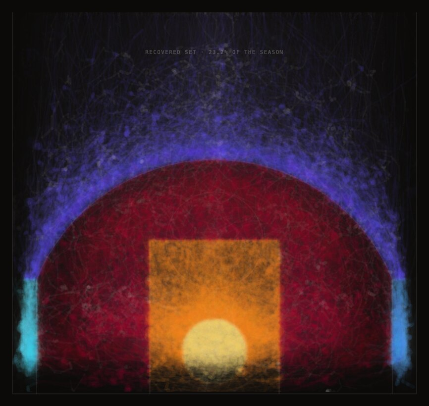

# FADEAWAY

Every regular-season NBA shot attempt since 1996, drawn on one half-court, showing where the
league's own record grew sharper, where it grew vaguer, and what it never wrote down. A browser
artwork and the data pipeline behind it, by Daniel Keinan: a Python pipeline over the shot logs
and the league's one public season of player tracking, a TypeScript renderer on Canvas 2D, and a
CI gate that checks every published figure.

[](https://github.com/dkdan10/analytics_resolution/actions/workflows/ci.yml)

**Live:** <https://dkdan10.github.io/analytics_resolution/> (a short guided overview, with the
full work one click away; made for a laptop screen) · **Paper:** [CONTESTED: How Data Is
Defined, Gathered, and Owned](https://dkdan10.github.io/papers/CONTESTED_Daniel_Keinan.pdf)

<p align="center">
  
</p>
<p align="center"><sub>THE HAND at the close of the tracking window. <a href="https://dkdan10.github.io/analytics_resolution/?mode=hand&amp;stop=hand.close">Open this frame live</a>.</sub></p>

## What it is

FADEAWAY draws the NBA's public shot data: 5,933,691 regular-season shot attempts over 30
seasons, from 1996-97 to 2025-26, plus the one stretch of 2015-16 for which the league's
optical player tracking is public. Every attempt lands on a single half-court that never
moves. What changes from era to era is the record itself: how finely it places a shot, which
shots it refuses to place, and what words it uses. The piece draws that resolution instead of
smoothing it over, and the companion paper argues what it means.

## How it is built

- **Pipeline** (`pipeline/`, Python, pandas, NumPy): mirrors the public archives, measures each
  season, joins every tracking game to the shot log, and writes derived JSON summaries and
  fixed-width binaries to `data/processed/`. No raw data enters the repository.
- **Renderer** (`site/`, TypeScript, Canvas 2D, Vite, no runtime dependencies): draws everything
  on one canvas from a single scrubbable time value. A frame is a function of `(mode, t)` and
  the loaded data, so any instant is URL-addressable and scrubbing backwards rebuilds rather
  than remembers.
- **Verification** (`pipeline/qa.py`, `pipeline/checks/`, `site/scripts/`): an acceptance gate
  holds each season's mid-range and three-point shares to a frozen reference table, decodes
  every shipped binary and recomputes its published statistics from the bytes, and holds every
  figure in this README to the artifact it came from. A fault-injection catalogue seeds defects into copies of the
  artifacts and documents, and each of 121 seeded defects must fail the specific check that
  owns it. The Python and TypeScript sides share one committed fixture for the league's zone map
  and one declared byte layout per binary format. CI runs the gate and the gated build on every
  push to master and every pull request. Details in [docs/verification.md](docs/verification.md).
- **The hard problem:** between the tracking feed and the shot log, the event numberings disagree
  in 101 of the 632 tracked games, by a small constant, so every shot in those games silently
  takes its neighbour's coordinate. Each game's offset is calibrated by letting its detected ball
  releases vote across a bounded search, with explicit rejection rules and a split-half check
  (`pipeline/window.py`, `decide_offset` and `game_event_offset`).

## Quick start

From the repository root, with Node 22 (`.nvmrc`) and Python 3.9 (`.python-version`);
[uv](https://docs.astral.sh/uv/) is the easiest way to get that Python.

```bash
uv venv --python 3.9 && source .venv/bin/activate     # or any Python 3.9 interpreter
uv pip install -r requirements.txt
python pipeline/qa.py --no-raw                        # under a minute; ends in QA GREEN (REDUCED ...)
cd site && npm ci
npm test && npm run build                             # source checks, then the gated build
npm run dev                                           # the piece, on a local Vite server
```

`--no-raw` is the public-clone mode: the raw archives are not committed, so the gate names the
checks it could not run and verifies everything else.

## What it found

- **The record's idea of "where" is not constant.** In 1996-97 the shot log files 95.4% of its
  shots at the rim on a single coordinate. From 2010-11 through 2013-14 it piles none there. Then
  the pile returns at new addresses: dunks first, then tip-ins and putbacks. 2015-16 is one of the
  6 seasons that file the pile away from the origin, and the only one a second instrument can
  check: the tracking cameras put those shots in nearly as many different places as there are
  shots, so the shared coordinate is a filing convention, not a location.
- **The mid-range drains away.** Measured with the league's own zone map, mid-range falls from
  39.9% of attempts in 1996-97 to 24.6% in 2015-16 and 10.0% in 2025-26. "Mid-Range" is the
  NBA's `SHOT_ZONE_BASIC` label, applied to 1996-97 retroactively; the piece also shows the share
  under the line then in force.
- **The archive learns adjectives as it stops saying where.** The record does not use the word
  Fadeaway until 2001-02.
- **Two instruments disagree about the same shot.** Where the scorer filed it and where the camera
  saw the ball leave the hand sit a median 4.82 ft apart over 84,271 detected shots, a wider
  set than the recovered one the defender measure below is built on. The spread includes join
  error as well as genuine disagreement, and it is structured, not noise.
- **One tracking statistic can be remade, once.** For 89 days in 2015-16 the optical feed was
  public, and closest-defender distance can be recomputed out of all 632 games from the 48,330
  shots the join recovers, a subset found by following the ball back from the rim, so it leans
  toward makes. After the window closes the league still publishes the categories, and nobody
  outside can compute them.

## The piece

Six renderings take turns over the same record, one per pass of the loop: the plate (evidence),
the field (the league's own colours), the ledger (its words), the census (its counts), the
measure (closest-defender distance, made in front of you) and the hand (paint, whose strokes
are real player trajectories). What varies from era to era is measured from that era's
archive; the constants that turn a measurement into a mark are authored, and each is named in
[docs/material-scalars.md](docs/material-scalars.md). Viewer entry points, presenter controls
and the URL grammar are in [docs/presenter.md](docs/presenter.md).

The companion paper, *CONTESTED: How Data Is Defined, Gathered, and Owned*, was written for
the course Theories, Methods, and Experiments in Art and AI. Its argument: an NBA
statistic is made the way an artwork is made. Someone chooses the instant, the subject and the
boundary, and the league publishes the result while keeping the choices. The only stretch where
anyone outside could re-derive a tracking number closed when the public optical feed ended.

## Layout, data and license

```
pipeline/          acquisition, aggregation, the gate and its defect catalogue, the tracking
                   window, the paint, the slate, the game, the cited facts, the palette measurement
data/processed/    committed derived JSON summaries and fixed-width binaries
site/              the renderer: Vite + TypeScript, Canvas 2D, one requestAnimationFrame loop
docs/              presenter notes, verification notes, the generated scalar disclosure
images/            the frame shown above
```

Code is MIT (`LICENSE`), covering the code only. `data/processed/` is derived from records the
NBA publishes via stats.nba.com (bulk archive
[shufinskiy/nba_data](https://github.com/shufinskiy/nba_data)) and from the public 2015-16
SportVU release ([linouk23](https://github.com/linouk23/NBA-Player-Movements) and mirrors;
play-by-play via [sealneaward](https://github.com/sealneaward/nba-movement-data)). It is
published for non-commercial academic and artistic use; no licence is granted for the data
itself, and no bulk raw data is committed. The site serves only the files on a reviewed
allowlist (`pipeline/deploy_allowlist.json`), checked against the real build.

The repository keeps its working title, `analytics_resolution`, because the paper and the live
URL cite it. Written in Python and TypeScript with the help of an AI coding assistant; the
questions, the data decisions, the rules and the verification design are the author's.
