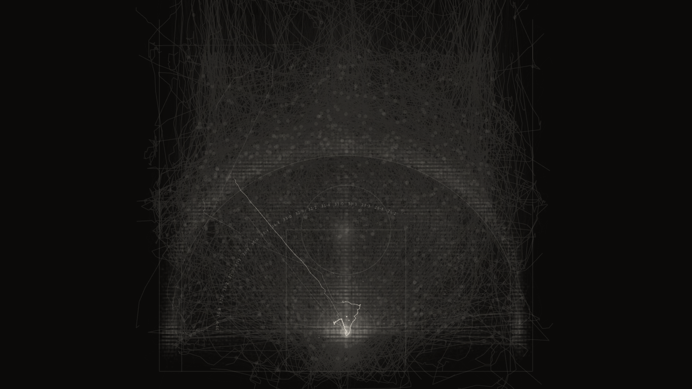

# FADEAWAY

*What the NBA's shot record could see, season by season.*

[](https://github.com/dkdan10/analytics_resolution/actions/workflows/verify.yml)

FADEAWAY is a browser artwork made from the NBA's public shot data: 5,933,691 regular-season
shot attempts over 30 seasons, from 1996-97 to 2025-26, plus the one stretch of 2015-16 for
which the league's optical player tracking is public. Every attempt lands on a single halfcourt
that never moves. What changes from era to era is the record itself: how finely it places a
shot, which shots it refuses to place, and what words it uses. The piece draws that resolution
instead of smoothing it over.

Underneath it, a Python pipeline turns the public archives into derived JSON summaries and
fixed-width binaries. A TypeScript/Canvas renderer draws them as a pure function of one time
value. An acceptance gate holds every figure on screen to the artifact it came from, and each of 121 seeded defects must turn its own check red.

**Live:** <https://dkdan10.github.io/analytics_resolution/>. A bare visit plays a short guided
overview. `?experience=full` opens the complete six-hand work without chrome, and `?talk` opens
it paused, with keyboard control. It is made for a laptop screen, full-screen, at normal
viewing distance.

<p align="center">
  
  
</p>
<p align="center"><sub>THE PLATE at <code>?mode=plate&amp;stop=window.crest</code> and THE HAND at <code>?mode=hand&amp;stop=hand.close</code>, rendered by <code>npm run shots</code> at native exposure.</sub></p>

FADEAWAY is the piece. `analytics_resolution` is its working title, kept as the repository name
because the companion paper cites this URL.

---

## The argument

An NBA statistic is made the way an artwork is made: someone chooses the instant, the subject
and the boundary, and the league publishes the result while keeping the choices. The shot record
shows this in its own geometry. Its idea of "where" changed from era to era, and the refusals it
files are as telling as the coordinates it keeps. The league's own definitions of a "contested"
shot cut across each other, and the only stretch where anyone outside could re-derive a tracking
number closed when the public optical feed ended. The piece draws the record's resolution; the
paper, *CONTESTED: How Data Is Defined, Gathered, and Owned*, written for the course Theories,
Methods, and Experiments in Art and AI, makes the case in words:
<https://dkdan10.github.io/papers/CONTESTED_Daniel_Keinan.pdf>.

## What it shows

- **The record's idea of "where" is not constant.** In 1996-97 the shot log files 95.4% of its
  shots at the rim on a single coordinate. From 2010-11 through 2013-14 it piles none there. Then
  the pile returns at new addresses: dunks first, then tip-ins and putbacks. The piece strikes
  each refusal as a pin, at the coordinate the record actually used.
- **The mid-range drains away.** Measured with the league's own zone map, mid-range falls from
  39.9% of attempts in 1996-97 to 24.6% in 2015-16 and 10.0% in 2025-26. "Mid-Range" is the
  NBA's `SHOT_ZONE_BASIC` label, applied to 1996-97 retroactively; the piece also shows the share
  under the line then in force.
- **The archive learns adjectives as it stops saying where.** The record does not use the word
  Fadeaway until 2001-02.
- **Joining tracking to the shot log is subtle.** In the public window, the event numberings
  disagree in 101 of the 632 tracked games: the two numberings are off by a small constant, so
  every shot silently takes its neighbour's coordinate. Each game's offset is calibrated by
  letting its releases vote, then checked by geometry.
- **Two instruments disagree about the same shot.** Where the scorer filed it and where the
  camera saw the ball leave the hand sit a median 4.82 ft apart over 84,271 detected shots, and
  the disagreement is structured, not noise.

---

## The piece

FADEAWAY is one monumental halfcourt that never moves while every season of the record migrates
out of its middle. What varies from era to era is measured from that era's archive; the
constants that turn a measurement into a mark are authored, and each one is named and disclosed
in [docs/material-scalars.md](docs/material-scalars.md). Grain is a measurement, not a mood.

What that resolution *was* is the piece's own finding, and it is not constant. The record refuses
to place some shots at all, and where it files that refusal moves: the whole rim in the earliest
era, then nothing from 2010-11 through 2013-14, then dunks, then tip-ins and putbacks. Every one
of those refusals is struck on the plate as **the pin**, at the coordinate the record actually
used. The 2015-16 pile is corroborated against a second instrument: the optical tracking feed
puts those shots in nearly as many places as there are shots, so the coordinate is a filing
convention and not a location. 2015-16 is one of the 6 seasons that file the pile away from the
origin, and the only one any public instrument can check; the others cannot be corroborated by
anything available today.

Six hands draw the same record in turn, one per pass of the loop: **the plate** (evidence), **the
field** (the league's own colours), **the ledger** (its words), **the census** (its counts), **the
measure**, and **the hand** (paint). The measure follows a single published statistic,
closest-defender distance, through its three states. For most of the piece no such measure
exists. For 89 days in 2015-16 the optical feed was public and the number can be *made*,
out of all 632 games, in front of you, from the 48,330 shots the join recovers, a subset that
leans toward makes. After the window closes, four figures stay lit above four empty calipers for
the rest of the loop: the league still publishes those categories, and those are the last figures
anyone outside could compute. The enclosure is of the geometry, not of the numbers.

**The hand** is the painting. Its brush strokes are real player trajectories from the window:
one body, five seconds, one possession, every vertex a position the machine recorded. Its colour
is the league's own seven-region map of the floor, so a stroke recolours along its own length as
it crosses the lines the NBA drew. Every season outside the window is splotches and nothing
between them, because that is all the record kept.

**The stack** is a seventh view, and it is not a hand. The six each render the whole record one
way; the stack renders nothing of its own. It composites the others' material over a single
shared base, one named interpretive operation at a time (LOCATE THE ATTEMPT, CLASSIFY THE FLOOR,
INSCRIBE THE SEASON, CONNECT THE BODY, MEASURE THE DEFENDER, NAME THE ACTION, COUNT THE EVENT,
JOIN THE INSTRUMENTS) and it opens with all of them switched off, on bare stone. Each control
names an act somebody performed on a list of coordinates rather than a renderer or a visual
effect. A presenter builds the image live, and ALL RENDERINGS applies every available operation
at once until it is released: the plate becomes illegible, which is the point, because maximal
rendering is not maximal access. It is **talk mode only** and is not in the gallery rotation,
which stays six.

---

## How it works

```
public archives ──► pipeline/ (Python) ──► data/processed/ ──► site/ (TypeScript, Canvas 2D)
 shot charts          acquire, aggregate     JSON summaries +      render(mode, t): a pure
 SportVU logs         window, paint, ...     fixed-width .bin      function of one float
                            │
                            └──► pipeline/qa.py: the acceptance gate, run before every deploy
```

**Pipeline.** `acquire.py` mirrors the thirty season dumps with a checksum manifest.
`aggregate.py` measures each season: zone shares, the fixed-seed sample, density grids, and the
record's own spatial regime. `window.py` parses every tracking game in the public window, joins
each shot to the camera's view of it, and folds the result into the measure, the occupancy
rasters and the per-shot disagreement. `paint.py` extracts the strokes THE HAND draws, one
possession per game. `slate.py` and `game.py` fold one night and one game. `facts.py` carries the
cited history and the derived schedule, so the renderer never types a date. `palette.py` measures
THE FIELD's seven hues against the league's own partition.

**Artifacts.** `data/processed/` holds the derived JSON summaries and fixed-width binaries the
site fetches: one record per occupied coordinate for the shot record, control points for the
strokes, the window's measures and quarrel. Raw dumps never enter the repository.

**Renderer.** `site/src/` draws everything on one canvas from a single scrubbable time value.
Scrubbing backwards rebuilds and never remembers; anything cached is keyed by everything that
affects its pixels, so emptying the cache changes no pixel and only costs time. Two modes come
from the same function: exhibit (wall clock, no chrome) and talk (keys, with a fermata).

**Glossary.** A *hand* is one complete way of drawing the record. *The Window* is the stretch
of 2015-16 for which the tracking feed is public. *The pin* is the mark for a shot the record
filed without a real location. *The quarrel* is the per-shot disagreement between the scorer's
coordinate and the camera's. *The plate* is the dark halfcourt every hand draws on.

The site and the pipeline also read each other on purpose: `facts.py` reads the renderer's
timeline, `palette.py` reads the renderer's palette, and `qa.py` reads the renderer's binary
decoders, so a claim can never drift from the code that draws it.

## The rules

1. **Honesty.** Every displayed or quoted number comes from a script output and is regenerable;
   none is hand-typed, in source comments included.
2. **Acceptance.** The pipeline reproduces a fixed acceptance table (`TABLE_1_6` in
   `pipeline/qa.py`) exactly. If the numbers differ, the pipeline is wrong.
3. **Grain is a measurement, not a mood.** Every material property of a mark derives from a
   measured property of that era's record; a constant that cannot be measured is named,
   isolated and disclosed in `docs/material-scalars.md`.
4. **Colour is measured, never chosen.** Hue exposes the NBA's own `SHOT_ZONE_BASIC` partition
   and never adds a classification of ours.
5. **Purity.** `render(mode, t)` is a pure function of one float.
6. **Data rights.** Bulk NBA data is never committed; derived data is.
7. **Every stroke stays one traceable record.** No particle systems, no synthesised motion, no
   mark standing for something nobody measured.

---

## Quick start

**See it.** Node only; no Python needed.

```bash
cd site && npm ci && npm run dev
```

**Verify it.** The gate runs against the committed artifacts. A public clone has no raw dumps
and none of the author's working notes, both gitignored, so the gate says REDUCED and names
what it did not check.

```bash
python3 -m venv .venv && source .venv/bin/activate
pip install -U pip            # the pinned interpreter's bundled pip cannot see numpy's arm64 wheel
pip install -r requirements.txt
python pipeline/qa.py --no-raw
```

The pins are frozen to the interpreter and libraries every published number was produced with
(`.python-version`, `requirements.txt`). `uv venv --python 3.9 && uv pip install -r
requirements.txt` works too.

**Rebuild from raw.** Two tiers. `python3 pipeline/acquire.py` mirrors the thirty shot dumps
(tens of megabytes) and unlocks the full gate, `python3 pipeline/qa.py` with no flags. The
tracking corpus (several gigabytes) unlocks the window, paint, slate and game stages below.

## Running the pipeline

```bash
python3 pipeline/acquire.py         # 30 season dumps -> data/shots/ + sha256 manifest
python3 pipeline/aggregate.py       # shares, samples, density grids, resolution regimes
python3 pipeline/qa.py              # acceptance gate: must reproduce the acceptance table exactly
python3 pipeline/sportvu_probe.py   # verifies the 2015-16 tracking corpus is still there
python3 pipeline/bloom.py           # the curated ball traces, anchored at their own shot dots
python3 pipeline/window.py --probe-gate   # must reproduce the committed corpus fixture first
python3 pipeline/window.py          # every tracking game -> the caliper, occupancy, the inventory
python3 pipeline/window.py --reduce       # fold the per-game artifacts into what the piece reads
python3 pipeline/paint.py           # THE HAND: the strokes, from one possession per game
python3 pipeline/paint.py --reduce
python3 pipeline/slate.py           # THE NIGHT: one slate of games, folded
python3 pipeline/game.py            # THE GAME: one full game, all ten bodies and the ball
python3 pipeline/facts.py           # the residue no dump supplies: cited history + derived schedule
python3 pipeline/palette.py         # measures THE FIELD's seven hues; the gate FAILS if it never ran
```

`bloom.py` and `window.py` need one of `py7zr`, `p7zip`, or `bsdtar` to read the corpus archives;
GNU tar cannot. The shot-record stages need none of them. `window.py` mirrors several gigabytes;
it writes one artifact per game, so a run resumes where it stopped and one bad archive costs one
game rather than the run. Leave `--jobs` alone: the stage is bound by memory rather than cores,
and more workers make it slower.

## The gate

`pipeline/qa.py` is an acceptance gate rather than a file-presence check. Every shipping artifact
is mandatory; every binary is decoded and asked what it means rather than measured; every
headline figure in `window.json` and `paint.json` is recomputed from the shipped bytes or by a
second implementation of the decision rule, which catches drift rather than a mis-specified rule.
**A bare run is the full shipping gate**: every check group, plus the mutation suite. It needs
the raw dumps from `acquire.py` and the author's working notes. Anything less prints
`QA GREEN (REDUCED - ...)` and says what it did not do, which is what a clone and CI run.

```bash
python3 pipeline/qa.py                 # the full shipping gate
python3 pipeline/qa.py --mutations     # the defect catalogue alone
python3 pipeline/qa.py --no-raw        # a public clone: says REDUCED
python3 pipeline/qa.py --slow          # + the recomputations that reopen the raw corpus
python3 pipeline/qa.py --write-deploy-allowlist   # regenerate pipeline/deploy_allowlist.json
cd site && npm test                    # the source-level checks the build runs
```

**The defect catalogue** lives in `pipeline/checks/mutations.py`. Every defect is reintroduced on a
copy of `data/processed/` and each is required to be caught **by the named check that owns it**:
a mutation caught only by some unrelated check is a failure of the suite, not a pass. The cases
that edit the local working notes are skipped on a public clone, and the run names them.

```bash
python3 pipeline/checks/mutations.py --list  # what each case is and which check owns it
python3 pipeline/checks/break_gates.py       # the same list, each through a real qa.py
                                             # subprocess on a mutated repo root (local only)
```

Add a gate, add its defect. A gate you cannot demonstrate going red is not evidence.

**Zone parity.** The league's seven-region map of the floor exists three times:
`pipeline/common.py:zone_at`, its vectorised twin `zone_at_np`, and `site/src/zone.ts:zoneAt`.
THE HAND colours a stroke by the region it is crossing, so a drift between them turns a
measurement into a decoration. All three are checked against one committed fixture, and neither
toolchain runs the other's: `python3 pipeline/qa.py` for the Python side, `cd site && npm run
gate` for the TypeScript side (`npm run build` calls it).

**Honesty in the renderer.** `site/scripts/check-numbers.mjs` scans the renderer's source in
three passes: printed strings carrying digits, comments quoting artifact values, and material
literals in the mark layers. `npm run disclose` regenerates `docs/material-scalars.md` from the
scalar register, and the build fails if it is stale.

## Probing the piece

Three diagnostics of the renderer, behind `?probe=`: `purity`, `perf` and `shots`. None is
reachable from the exhibit path: `main.ts` imports the probe module dynamically and only when
the parameter is present, so the gallery build never fetches the chunk and a probe run never
starts the loop. None is wired into `npm run build`: a purity sweep takes minutes, and
performance numbers are a property of the machine that took them.

```bash
cd site && npm run dev                    # in one shell; the probes need the data synced
cd site && npm run probe:purity           # the same instant reached four ways, compared by hash
cd site && npm run probe:perf -- --assert-presentation
cd site && npm run shots -- --list hands  # exact frames, for looking at
```

The probes and `shots` drive an installed Google Chrome through Playwright. Verdicts land in
`docs/probe/`, which is gitignored: a verdict is machine output, regenerated by re-running the
probe. `--mode`, `--beat`, `--ops` and `--out` narrow a run and name its output; **`--out` is a
NAME, not a path**, and an unmatched name is an error rather than an empty table. Read the
**RENDERER** arm: the history warms the caches on a scratch surface and the tested frame is drawn
on a virgin one, so a difference there is renderer state; `row.surfaceArm` is a kept second
reading and carries no verdict.

Read every purity verdict against the run's own measured **noise floor**: Canvas2D rasterisation
is not bit-stable under memory pressure, and an uncalibrated run blames the piece for the
browser. The floor is a property of the frame, so it is measured on the densest one in the
sweep. The floor is not the tolerance: `aboveNoise` keeps a hard floor of its own whatever it
measures. `&exact=1` pins software rasterisation instead: the floor drops to zero and the run
takes hours. `npm run shots` is **not a gate and must not become one**.

## Viewer entry and presenter controls

The renderer reads one deterministic score; these routes decide how it is sampled and whether
working controls are visible.

- A bare `/` plays the **guided overview**: an introduction, one named Window chapter for each
  of the six hands, and a coda. `?experience=overview` requests it explicitly.
- `?experience=full` plays the canonical **full work** without chrome: six complete passes in
  the order plate, field, ledger, census, measure, hand. A moving pointer shows the cursor
  briefly; Escape returns to the overview.
- `?talk` opens the full work with the presenter rail and starts **paused**; `&autoplay=1` begins
  moving immediately. `?nav` adds the rail to an autoplaying full view; `?nav=0` removes it.
- Direct addresses (`?t=<seconds>`, `?year=<YYYY>`, `?stop=<semantic-id>`, `?mode=<id>`,
  `?ops=<letters>`) select the full work. `?stop=` is the durable presenter form (`hand.game`,
  `plate.shell`, `ledger.crest`, `census.machine-saw`, `measure.terminal`, `window.crest`).
  **CITE THIS FRAME** uses a semantic stop when the playhead is on one and an exact `t` otherwise.
- `?display=near|room` selects viewer-distance legibility. Talk mode defaults to `room`; other
  entries default to `near`.

Keys: `space` pause · `f` fermata · `0` start · `1`–`5` acts · `6`–`9` the four **shared** Window
beats · `w` Window · `x` the cut · `,` `.` previous/next scored stop · `h` hand. Pinning a hand
changes the Window sub-stops and scrub ticks to that hand's interior; it does not move the shared
`6`–`9` anchors. The Window's shared score has four beats (ONE, NIGHT, SEASON, CLOSE) on those
keys.

**THE STACK is presenter-only**: `?mode=stack` is refused without `?talk` or a visible `?nav`. Its
eight operations take one letter each (`l` `c` `i` `b` `d` `n` `e` `j`, with `a` for ALL
RENDERINGS), and the same letters form the URL token. CONNECT, MEASURE and JOIN are Window-only. A
configured frame such as `?talk&mode=stack&ops=lcij&stop=window.crest` is reopenable without
replaying the button presses.

## Deploying, and what is public

```bash
cd site && npm run deploy:pages   # the gated build, then publish dist/ to gh-pages
```

That is the whole of a re-deploy. CI verifies and never publishes.

**The site serves one list.** It is the `public` column of `REQUIRED_ARTIFACTS` in
`pipeline/qa.py`, written to `pipeline/deploy_allowlist.json` by `--write-deploy-allowlist`.
`sync-data.mjs` copies only what that list names and fails on anything unlisted;
`check-public-data.mjs` grades the real `dist/`. To publish something new: flip its value,
regenerate, commit.

**The repository carries another list:** all of `data/processed/`, including files the site does
not serve, because holding them back would make the pipeline unreproducible. No raw data:
`data/shots/`, `data/raw/` and `data/window/` are gitignored, and
`git ls-files data/ | grep -v processed` prints nothing.

**Published by decision.** `points/*.bin` ships whole, every occupied coordinate, not coarsened
or sampled. `traces.json` ships player names, game and event ids, matchups and dates. The paint
binaries ship anonymised scenes: simplified control points folded onto one halfcourt, with no
player, game, event or clock.

## Repository layout

```
README.md          this file
LICENSE            MIT, covering the code
pipeline/          acquisition, aggregation, the QA gate and its defect catalogue, the corpus
                   probe, the window, the paint, the slate, the game, the cited facts, the
                   palette measurement
data/processed/    committed derived JSON summaries and fixed-width binaries
site/              FADEAWAY: Vite + TypeScript, Canvas 2D, one requestAnimationFrame loop
docs/              the generated scalar disclosure
images/            the frames shown above, rendered by npm run shots
```

Some code comments carry identifiers from the author's private working notes (milestone and
review ids). The decisions they refer to are stated in the code where they apply.

## Data & license

Code is MIT (see `LICENSE`), covering the code only. `data/processed/` is derived from records
the NBA publishes via stats.nba.com (bulk archive
[shufinskiy/nba_data](https://github.com/shufinskiy/nba_data)) and from the public 2015-16
SportVU release ([linouk23](https://github.com/linouk23/NBA-Player-Movements) and mirrors;
play-by-play via [sealneaward](https://github.com/sealneaward/nba-movement-data)). It is
published for non-commercial academic and artistic use; no licence is granted for the data
itself, and no bulk raw data is committed.
