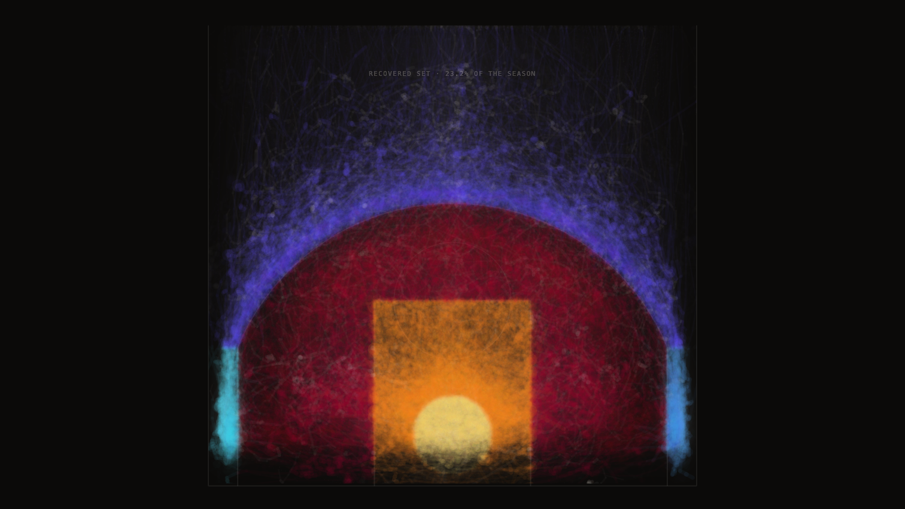

# FADEAWAY

*What the NBA's shot record could see, season by season.* A browser artwork by Daniel Keinan.

[](https://github.com/dkdan10/analytics_resolution/actions/workflows/verify.yml)

**Live:** <https://dkdan10.github.io/analytics_resolution/> (a short guided overview; `?experience=full`
is the complete work, `?talk` opens it paused with keyboard control). Made for a laptop screen.
FADEAWAY is the piece; `analytics_resolution` is its working title, kept as the repository name
because the companion paper cites this URL.

<p align="center">
  
</p>
<p align="center"><sub>THE HAND at <code>?mode=hand&amp;stop=hand.close</code>, rendered by <code>npm run shots</code> at native exposure.</sub></p>

## In one paragraph

FADEAWAY draws the NBA's public shot data: 5,933,691 regular-season shot attempts over 30 seasons,
from 1996-97 to 2025-26, plus the one stretch of 2015-16 for which the league's optical player
tracking is public. Every attempt lands on a single halfcourt that never moves. What changes from
era to era is the record itself: how finely it places a shot, which shots it refuses to place, and
what words it uses. The piece draws that resolution instead of smoothing it over.

## For engineers

- **Pipeline** (`pipeline/`, Python): mirrors the public archives, measures each season, joins
  every tracking game to the shot log, and writes derived JSON summaries and fixed-width binaries
  to `data/processed/`. No raw data enters the repository.
- **Renderer** (`site/`, TypeScript, Canvas 2D, Vite): draws everything on one canvas from a
  single scrubbable time value; `render(mode, t)` is a pure function of one float, so scrubbing
  backwards rebuilds and never remembers.
- **Gate** (`pipeline/qa.py`): reproduces a fixed acceptance table exactly, decodes every shipped
  binary, and holds every figure on screen to the artifact it came from. A fault-injection
  catalogue seeds defects into copies of the artifacts and documents, and each of 121 seeded
  defects must fail the specific check that owns it. CI runs the gate and the build on every push.
- **The hard problem:** between the tracking feed and the shot log, the event numberings
  disagree in 101 of the 632 tracked games, by a small constant, so every shot silently takes
  its neighbour's coordinate. Each game's offset is calibrated by letting its releases vote,
  then checked on a held-out split (`pipeline/window.py`, `game_event_offset`).

```bash
cd site && npm ci && npm run dev          # see it (Node only)
uv venv --python 3.9 && source .venv/bin/activate && uv pip install -r requirements.txt
python pipeline/qa.py --no-raw            # verify it on a public clone (prints REDUCED, says why)
```

## What it shows

- **The record's idea of "where" is not constant.** In 1996-97 the shot log files 95.4% of its
  shots at the rim on a single coordinate. From 2010-11 through 2013-14 it piles none there. Then
  the pile returns at new addresses: dunks first, then tip-ins and putbacks. The piece strikes
  each refusal as a pin, at the coordinate the record actually used.
- **The mid-range drains away.** Measured with the league's own zone map, mid-range falls from
  39.9% of attempts in 1996-97 to 24.6% in 2015-16 and 10.0% in 2025-26. "Mid-Range" is the
  NBA's `SHOT_ZONE_BASIC` label, applied to 1996-97 retroactively; the piece also shows the share
  under the line then in force.
- **The archive learns adjectives as it stops saying where.** The record does not use the word
  Fadeaway until 2001-02.
- **Two instruments disagree about the same shot.** Where the scorer filed it and where the
  camera saw the ball leave the hand sit a median 4.82 ft apart over 84,271 detected shots, and
  the disagreement is structured, not noise.

## The piece

Six hands draw the same record in turn, one per pass of the loop: **the plate** (evidence), **the
field** (the league's own colours), **the ledger** (its words), **the census** (its counts), **the
measure**, and **the hand** (paint, whose strokes are real player trajectories from the window).
What varies from era to era is measured from that era's archive; the constants that turn a
measurement into a mark are authored, and each is named and disclosed in
[docs/material-scalars.md](docs/material-scalars.md). Grain is a measurement, not a mood.

The record refuses to place some shots at all, and where it files that refusal moves: the whole
rim in the earliest era, then nothing from 2010-11 through 2013-14, then dunks, then tip-ins and
putbacks. The 2015-16 pile is corroborated against a second instrument: the optical feed puts
those shots in nearly as many places as there are shots, so the coordinate is a filing convention
and not a location. 2015-16 is one of the 6 seasons that file the pile away from the origin, and
the only one any public instrument can check; the others cannot be corroborated by anything
available today.

The measure follows one published statistic, closest-defender distance. For most of the piece no
such measure exists. For 89 days in 2015-16 the optical feed was public and the number can be
*made*, out of all 632 games, in front of you, from the 48,330 shots the join recovers, a subset
that leans toward makes. After the window closes, four figures stay lit above four empty
calipers: the league still publishes those categories, and those are the last figures anyone
outside could compute. A seventh view, **the stack**, is presenter-only: it composites the
others' material one named interpretive operation at a time, and with everything applied the
plate becomes illegible, which is the point.

## The argument

An NBA statistic is made the way an artwork is made: someone chooses the instant, the subject
and the boundary, and the league publishes the result while keeping the choices. The record shows
this in its own geometry, the league's definitions of a "contested" shot cut across each other,
and the only stretch where anyone outside could re-derive a tracking number closed when the
public optical feed ended. The companion paper, *CONTESTED: How Data Is Defined, Gathered, and
Owned*, written for the course Theories, Methods, and Experiments in Art and AI, makes the case:
<https://dkdan10.github.io/papers/CONTESTED_Daniel_Keinan.pdf>.

## The rules

1. **Honesty.** Every displayed or quoted number comes from a script output and is regenerable;
   none is hand-typed. The figures in this file are gated claims, checked against the artifacts.
2. **Acceptance.** The pipeline reproduces a fixed acceptance table (`TABLE_1_6` in
   `pipeline/qa.py`) exactly. If the numbers differ, the pipeline is wrong.
3. **Grain is a measurement, not a mood.** A material property that cannot be measured is named,
   isolated and disclosed.
4. **Colour is measured, never chosen.** Hue exposes the NBA's own zone partition and never adds a
   classification of ours.
5. **Purity.** `render(mode, t)` is a pure function of one float.
6. **Data rights.** Bulk NBA data is never committed; derived data is.
7. **Every stroke stays one traceable record.** No particle systems, no synthesised motion.

## The gate

A bare `python3 pipeline/qa.py` is the full shipping gate: every check group plus the fault
catalogue. It needs the raw dumps from `acquire.py` and the author's working notes, both
gitignored, so a public clone runs `--no-raw`, prints `QA GREEN (REDUCED - ...)` and names what it
did not check. Each defect in `pipeline/checks/mutations.py` is reintroduced on a copy and must be
caught by the named check that owns it; a catch by an unrelated check is a failure of the suite.
The league's seven-region map of the floor exists in Python and in TypeScript, and both are held
to one committed fixture (`npm run gate`). `site/scripts/check-numbers.mjs` scans the renderer's
source for any digit that did not come from an artifact, and `npm run disclose` regenerates the
scalar disclosure, which the build checks.

```bash
python3 pipeline/qa.py                       # the full gate (raw dumps + notes present)
python3 pipeline/qa.py --no-raw              # a public clone
python3 pipeline/checks/mutations.py --list  # every seeded defect and the check that owns it
python3 pipeline/checks/break_gates.py       # the same catalogue through real subprocesses (local only)
cd site && npm test && npm run build         # the source checks, then the gated seven-step build
```

<details>
<summary><b>Running the pipeline</b> (from the raw archives)</summary>

```bash
python3 pipeline/acquire.py         # 30 season dumps -> data/shots/ + sha256 manifest
python3 pipeline/aggregate.py       # shares, samples, density grids, resolution regimes
python3 pipeline/qa.py              # acceptance gate: must reproduce the acceptance table exactly
python3 pipeline/sportvu_probe.py   # verifies the 2015-16 tracking corpus is still there
python3 pipeline/bloom.py           # the curated ball traces, anchored at their own shot dots
python3 pipeline/window.py --probe-gate   # must reproduce the committed corpus fixture first
python3 pipeline/window.py          # every tracking game -> the caliper, occupancy, the inventory
python3 pipeline/window.py --reduce       # fold the per-game artifacts into what the piece reads
python3 pipeline/paint.py           # THE HAND: the strokes, from one possession per game
python3 pipeline/paint.py --reduce
python3 pipeline/slate.py           # THE NIGHT: one slate of games, folded
python3 pipeline/game.py            # THE GAME: one full game, all ten bodies and the ball
python3 pipeline/facts.py           # the residue no dump supplies: cited history + derived schedule
python3 pipeline/palette.py         # measures THE FIELD's seven hues; the gate FAILS if it never ran
```

`acquire.py` mirrors tens of megabytes and unlocks the full gate; the tracking corpus is several
gigabytes and unlocks the window, paint, slate and game stages. `bloom.py` and `window.py` need
one of `py7zr`, `p7zip` or `bsdtar` to read the archives. `window.py` writes one artifact per
game, so a run resumes where it stopped; leave `--jobs` alone, the stage is bound by memory. The
pins in `.python-version` and `requirements.txt` are the interpreter and libraries every published
number was produced with.
</details>

<details>
<summary><b>Probing the piece</b> (purity, perf, frames)</summary>

Three diagnostics sit behind `?probe=`: `purity`, `perf` and `shots`. None is reachable from the
exhibit path and none is wired into the build. They drive an installed Google Chrome through
Playwright against `npm run dev`; verdicts land in the gitignored `docs/probe/`.

```bash
cd site && npm run probe:purity           # the same instant reached four ways, compared by hash
cd site && npm run probe:perf -- --assert-presentation
cd site && npm run shots -- --list hands  # exact frames, for looking at
```

Read a purity verdict on the **RENDERER** arm against the run's own measured noise floor: Canvas2D
rasterisation is not bit-stable under memory pressure, and `aboveNoise` keeps a hard floor of its
own. `--out` is a NAME, not a path. `npm run shots` is not a gate and must not become one.
</details>

<details>
<summary><b>Viewer entry and presenter controls</b></summary>

- A bare `/` plays the guided overview; `?experience=full` plays the complete work without chrome
  (a moving pointer shows the cursor briefly; Escape returns to the overview); `?talk` opens the
  full work with the presenter rail, paused (`&autoplay=1` to start moving); `?nav` adds the rail
  to an autoplaying full view.
- Direct addresses: `?t=<seconds>`, `?year=<YYYY>`, `?stop=<semantic-id>`, `?mode=<id>`,
  `?ops=<letters>`. `?stop=` is the durable presenter form (`hand.game`, `plate.shell`,
  `ledger.crest`, `census.machine-saw`, `measure.terminal`, `window.crest`). **CITE THIS FRAME** in
  the rail copies one.
- `?display=near|room` selects viewer-distance legibility; talk mode defaults to `room`.
- Keys: `space` pause · `f` fermata · `0` start · `1`–`5` acts · `6`–`9` the four shared Window
  beats · `w` Window · `x` the cut · `,` `.` previous/next scored stop · `h` hand.
- **THE STACK is presenter-only** (`?mode=stack` needs `?talk` or a visible `?nav`). Its eight
  operations take one letter each (`l` `c` `i` `b` `d` `n` `e` `j`, `a` for ALL RENDERINGS), and
  the same letters form the URL token, so a configured frame such as
  `?talk&mode=stack&ops=lcij&stop=window.crest` is reopenable.
</details>

## Deploying, and what is public

`cd site && npm run deploy:pages` runs the gated build and publishes `dist/` to `gh-pages`. CI
verifies and never publishes. The site serves exactly one list: the `public` column of
`REQUIRED_ARTIFACTS` in `pipeline/qa.py`, written to `pipeline/deploy_allowlist.json`, copied by
`sync-data.mjs` and graded on the real `dist/` by `check-public-data.mjs`. The repository carries
all of `data/processed/`, served or not, so the pipeline stays reproducible; no raw data is
tracked. Published by decision: `points/*.bin` whole, `traces.json` with player names, game ids,
matchups and dates, and anonymised paint scenes with no player, game, event or clock.

## Layout, data and license

```
pipeline/          acquisition, aggregation, the gate and its defect catalogue, the window,
                   the paint, the slate, the game, the cited facts, the palette measurement
data/processed/    committed derived JSON summaries and fixed-width binaries
site/              the renderer: Vite + TypeScript, Canvas 2D, one requestAnimationFrame loop
docs/              the generated scalar disclosure
images/            the frame shown above
```

Code is MIT (`LICENSE`), covering the code only. `data/processed/` is derived from records the
NBA publishes via stats.nba.com (bulk archive
[shufinskiy/nba_data](https://github.com/shufinskiy/nba_data)) and from the public 2015-16
SportVU release ([linouk23](https://github.com/linouk23/NBA-Player-Movements) and mirrors;
play-by-play via [sealneaward](https://github.com/sealneaward/nba-movement-data)). It is
published for non-commercial academic and artistic use; no licence is granted for the data
itself, and no bulk raw data is committed. Some code comments carry identifiers from the author's
private working notes; the decisions they refer to are stated in the code where they apply.
